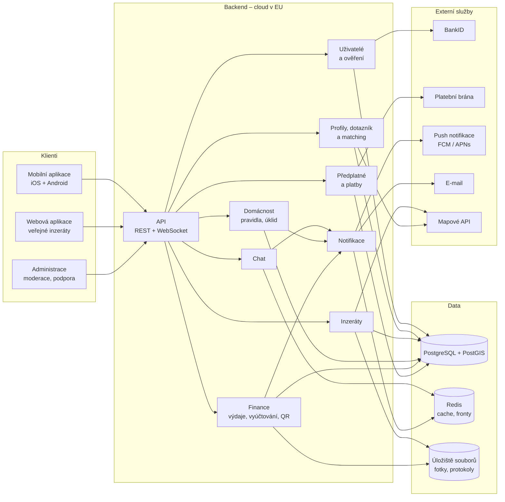
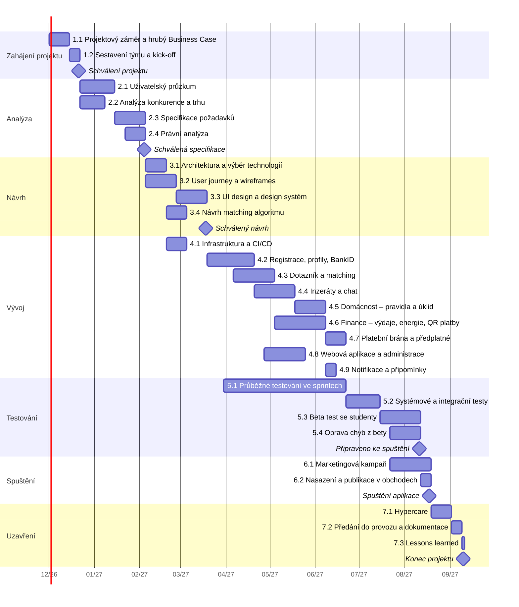

# 1. část semestrálního projektu – Spolubyt

Pracovní verze k revizi týmem. Požadavky na obsah viz [podklady.md](podklady.md#1-část--prezentace-a-odevzdání).
Odevzdává se jako prezentace: Lean Canvas, architektura aplikace, harmonogram včetně ohodnocení a sazeb, persony.

| Soubor | Obsah |
|---|---|
| [spolubyt-cast-1.pptx](spolubyt-cast-1.pptx) | prezentace (15 slajdů, poznámky pro řečníka) |
| [spolubyt-harmonogram.xlsx](spolubyt-harmonogram.xlsx) | příloha – Gantt, harmonogram se vzorci, zdroje a sazby |

Tento dokument je zdroj obsahu; při změně obsahu se upraví zde a prezentace a Excel se přegenerují.

## Idea

**Spolubyt** (pracovní název) je mobilní a webová aplikace pro sdílené bydlení. Pomáhá najít spolubydlícího
podle kompatibility životního stylu a pak společnou domácnost spravovat: pravidla soužití, rozpis úklidu
a společné finance včetně rozpočítání nájmu a energií.

> Najdi spolubydlícího, se kterým budeš chtít bydlet i za půl roku. Od prvního seznámení po vyúčtování
> energií v jedné aplikaci.

## Lean Canvas

### 1. Problém

1. **Hledání naslepo** – FB skupiny a inzeráty neřeknou nic o životním stylu člověka, se kterým budu bydlet; hrozí podvody (falešné inzeráty, zálohy předem).
2. **Konflikty v soužití** – úklid, hluk, návštěvy, společné nákupy; pravidla nejsou nikde sepsaná.
3. **Peníze v domácnosti** – rozpočítání nájmu a záloh na energie, doplatky z vyúčtování, dluhy mezi spolubydlícími, chaos při odchodu jednoho z nich.

Velikost problému: v Praze studuje 137 700 vysokoškoláků, z toho 77 200 z jiných krajů, studentských lůžek je
ale jen 27 900 (Cushman & Wakefield, Student Housing 2026). Zbytek hledá bydlení na volném trhu, typicky ve sdíleném bytě.

### 2. Alternativy

- FB a Telegram skupiny typu „Spolubydlení Praha“ – i oficiální průvodce pro cizince varuje před podvody
- inzertní portály (Sreality, Bezrealitky) – řeší byt, ne člověka
- Badi – zahraniční aplikace na hledání pokoje a spolubydlících, bez správy domácnosti
- Flatastic – úklid, nákupy a výdaje domácnosti, bez hledání spolubydlících a bez českých specifik
- Splitwise, WhatsApp skupina + Excel

### 3. Řešení

1. **Matching podle kompatibility** – dotazník životního stylu (denní režim, úklid, hluk, návštěvy, kouření, zvířata, rozpočet, lokalita), ověřené profily přes BankID a hodnocení od předchozích spolubydlících.
2. **Dohoda o soužití** ze šablony + rozpis úklidu s rotací a připomínkami.
3. **Společné finance** – rozpočítání nájmu a energií, evidence nákupů, vyrovnání dluhů QR platbou, přepočet při příchodu nebo odchodu spolubydlícího.

### 4. Jedinečnost řešení (hodnota)

Jediná aplikace, která spojuje **výběr spolubydlícího** a **každodenní soužití**. Spolubydlící vybíráš podle
toho, jak žije, ne jen podle ceny pokoje, a domácnost pak běží bez honění dluhů a hádek o úklid.

### 5. Nefér výhoda

- **Síťový efekt reputace** – hodnocení od spolubydlících roste s každou domácností a nejde přenést ke konkurenci.
- **Data o reálném soužití** zpětně zpřesňují matching (kdo spolu vydržel bydlet).
- **Ambasadoři na vysokých školách** – přímý kanál ke studentům.

### 6. Zákazníci

- **Hledající** – VŠ studenti (19–26 let) a mladí pracující (do 30 let) v univerzitních městech
- **Nabízející** – hlavní nájemníci a stávající spolubydlící, kteří hledají náhradu za odcházejícího
- **Domácnosti** – sdílené byty, které chtějí mít pořádek v úklidu a financích
- **Zahraniční studenti** – hledají bydlení na semestr na dálku

### 7. První vlaštovky

- studenti, kteří v létě před zimním semestrem odcházejí z kolejí do bytu
- zahraniční studenti na semestr (Erasmus)
- sdílené byty, kde během semestru odchází spolubydlící
- pilotní město: Praha

### 8. Jak měřit úspěch

- počet dokončených profilů (vyplněný dotazník)
- trychtýř match → chat → prohlídka → nastěhování
- počet aktivních domácností a jejich retence po 3 a 6 měsících
- konverze na placené služby
- průměrné hodnocení soužití

### 9. Distribuční kanály

- studentské komunity na Instagramu, TikToku a FB, ambasadoři na fakultách
- ESN a buddy programy pro zahraniční studenty, welcome weeks
- spolupráce s kolejemi a univerzitami (nástěnky, e-maily)
- virální smyčka: domácnost pozve ostatní spolubydlící (každá domácnost = 2–4 uživatelé)
- SEO na dotazy typu „spolubydlení Praha“

### 10. Struktura nákladů

- projekt celkem 3,28 mil. Kč (lidé 3,03 mil. + materiál 0,26 mil.), z toho 3,14 mil. Kč do spuštění (viz [Náklady projektu](#náklady-projektu))
- provoz: cloud, údržba a další vývoj, zákaznická podpora
- poplatky za transakce: ověření identity, platební brána, App Store / Google Play
- marketing a ambasadoři
- právní služby (GDPR, obchodní podmínky)

### 11. Struktura příjmů

Freemium – základní hledání a správa domácnosti zdarma, bez reklam. Ceny jsou orientační, upřesní je Business Case.

| Služba | Kdo platí | Cena |
|---|---|---|
| Inzerát volného pokoje | nabízející | 199 Kč / 30 dní |
| Premium hledání – ověřený profil, neomezené matche, zvýraznění | hledající | 99 Kč / měsíc za osobu |
| Premium domácnost – vyúčtování energií, přepočty při změně spolubydlících, automatické připomínky plateb, export | domácnost | 99 Kč / měsíc za celou domácnost |

## Persony

Fotografie person jsou v prezentaci (AI generované portréty). Typy podle zadání: zákazník, potenciální zákazník, anti-zákazník.

### Tereza Nováková – zákazník (hledající)

| | |
|---|---|
| Věk, bydliště | 20 let, pochází z Havlíčkova Brodu, teď bydlí na koleji v Praze |
| Zaměstnání | studentka 2. ročníku ekonomie, brigáda v kavárně cca 10 h týdně |
| Ekonomický status | na bydlení max. 9 000 Kč měsíčně včetně energií (část platí rodiče) |
| Situace | od září chce z koleje do sdíleného bytu |
| Bolesti | na koleji měla nepořádnou spolubydlící; na FB po ní někdo chtěl zálohu ještě před prohlídkou |
| Cíle a motivace | klid na učení, max. 30 minut MHD do školy, spolubydlící s podobným režimem (nekuřák, ranní ptáče) |
| Jak aplikaci používá | v létě vyplní dotazník, prochází matche, chatuje a domluví prohlídky; po nastěhování používá rozpis úklidu |
| Zájmy | jóga, čtení, vaření |
| Zdravotní stav a omezení | alergie na kočky – hledá byt bez zvířat |
| Za co platí | Premium hledání na 1–2 měsíce |
| Charakter | laik, spíš konzervativní, kvalita > kvantita, šetří, střední smysl pro humor |

> „Radši zaplatím o pár stovek víc, než abych rok bydlela s někým, kdo nikdy neumyje nádobí.“

### Martin Dvořák – zákazník (hlavní nájemník, hlavní plátce)

| | |
|---|---|
| Věk, bydliště | 27 let, byt 3+kk na Smíchově se dvěma spolubydlícími |
| Zaměstnání | vývojář v IT firmě, pracuje hybridně |
| Ekonomický status | čistý příjem cca 55 000 Kč měsíčně, za pohodlí rád zaplatí |
| Situace | nájemní smlouva je na něj – posílá nájem majiteli, platí zálohy na energie, při vyúčtování dopočítává a vybírá doplatky |
| Bolesti | honí dluhy přes WhatsApp a Excel; spolubydlící odchází v půlce semestru a pokud nenajde rychle náhradu, doplácí nájem sám |
| Cíle a motivace | průhledné a automatické finance, náhradu za spolubydlícího do měsíce |
| Jak aplikaci používá | každý týden – evidence nákupů, připomínky plateb; při odchodu spolubydlícího vystaví inzerát a vybírá zájemce podle kompatibility |
| Zájmy | lezení, deskové hry, homelab |
| Zdravotní stav a omezení | 2 dny v týdnu pracuje z domu – záleží mu na klidu a hluku v bytě |
| Za co platí | Premium domácnost + inzeráty |
| Charakter | odborník, moderní, kvalita > kvantita, utrácí za pohodlí, výrazný smysl pro humor |

> „Nechci být bankou svých spolubydlících.“

### Lucía Fernández – potenciální zákazník (Erasmus)

| | |
|---|---|
| Věk, bydliště | 22 let, Valencie (Španělsko), na zimní semestr 2027/28 v Praze |
| Zaměstnání | studentka architektury na Erasmu |
| Ekonomický status | stipendium + úspory, na bydlení do 450 € měsíčně |
| Situace | potřebuje pokoj na zimní semestr 2027/28, byt nemůže předem vidět osobně; česky neumí |
| Bolesti | strach z podvodu (záloha za byt, který neviděla), jazyková bariéra, drahé krátkodobé nájmy |
| Cíle a motivace | ověření lidé, anglické rozhraní, spolubydlící, kteří ji vezmou mezi sebe |
| Jak aplikaci používá | hledá z domova hned po spuštění aplikace v srpnu 2027, se spolubydlícími se seznámí přes chat a videohovor, po příjezdu se připojí k domácnosti |
| Zájmy | fotografie, cestování, salsa |
| Zdravotní stav a omezení | neumí česky, nízký rozpočet |
| Za co platí | Premium hledání jednorázově |
| Charakter | moderní, společenská, zážitky > majetek, šetří, výrazný smysl pro humor |

> „Nechci posílat zálohu za pokoj, který jsem nikdy neviděla.“

Sezónní zákaznice s nízkou celoživotní hodnotou, ale se silným doporučením v ESN komunitě.

### Anti-zákazník: Ing. Pavel Horák – pronajímatel

> „Potřebuju byty pronajmout rychle a draze. Kdo s kým bydlí, mě nezajímá.“

48 let, vlastní 6 bytů v Praze. Chce hromadně inzerovat, maximalizovat výnos a neřeší, kdo s kým bydlí.
**Není naším zákazníkem** – potřebuje realitní portál a správu nemovitostí. Jeho požadavky (hromadné
inzeráty, správa nájemních smluv) by aplikaci odvedly od soužití spolubydlících.

## Architektura aplikace

### Moduly

| Modul | Odpovědnost |
|---|---|
| Uživatelé a ověření | registrace, přihlášení, ověření identity přes BankID, hodnocení od spolubydlících |
| Profily, dotazník a matching | dotazník životního stylu, výpočet skóre kompatibility, doporučení |
| Inzeráty | nabídky volných pokojů, fotky, poloha a dojezdová doba do školy |
| Chat | zprávy mezi zájemci a domácností v reálném čase |
| Domácnost | členové, dohoda o soužití, rozpis úklidu s rotací |
| Finance | společné výdaje, rozpočítání nájmu a energií, vyúčtování, vyrovnání dluhů QR platbou |
| Předplatné a platby | placené služby přes platební bránu |
| Notifikace | připomínky úklidu a plateb, nové matche a zprávy |

### Technologie (návrh)

| Vrstva | Volba | Proč |
|---|---|---|
| Mobilní aplikace | React Native | jeden kód pro iOS i Android, sdílí znalosti s webem |
| Web | React (Next.js) | veřejné inzeráty indexované vyhledávači (SEO) |
| Backend | Node.js (NestJS), modulární monolit | malý tým; moduly lze později oddělit do samostatných služeb |
| Databáze | PostgreSQL + PostGIS | relační data (domácnosti, platby) a geodotazy (vzdálenost od školy) |
| Cache a fronty | Redis | chat v reálném čase, fronta notifikací |
| Hosting | Azure, region v EU | data uživatelů zůstávají v EU (GDPR) |

Vyrovnání dluhů mezi spolubydlícími probíhá přes **QR platbu** – aplikace jen vygeneruje QR kód a peníze jdou
přímo z účtu na účet. Aplikace tak nedrží peníze uživatelů (to by vyžadovalo licenci ČNB pro platební služby)
a neplatí z těchto plateb poplatky. Platební brána slouží jen pro placené služby aplikace.

## Harmonogram

### Předpoklady

- Začátek projektu 1. 12. 2026; pracovní dny Po–Pá bez státních svátků ČR, 8 h denně.
- Cíl: spuštění před zimním semestrem 2027, kdy studenti nejvíc hledají bydlení – **18. 8. 2027**.
- Sazby jsou orientační náklady zaměstnavatele na hodinu práce včetně odvodů.
- Náklady činnosti = dny × 8 h × úvazek × sazba. Materiálové a ostatní náklady viz [Náklady projektu](#náklady-projektu).

### Tým a sazby

| Role | Počet | Sazba (Kč/h) | Člověkodny | Náklady (Kč) |
|---|---:|---:|---:|---:|
| Projektový manažer (PM) | 1 | 600 | 117 | 561 600 |
| Business analytik (ANA) | 1 | 500 | 57,5 | 230 000 |
| UX/UI designer (UX) | 1 | 500 | 52,5 | 210 000 |
| Architekt / lead developer (ARCH) | 1 | 750 | 38,75 | 232 500 |
| Backend developer (BE) | 2 | 650 | 137,5 | 715 000 |
| Frontend / mobilní developer (FE) | 2 | 650 | 125 | 650 000 |
| Tester (QA) | 1 | 400 | 90 | 288 000 |
| Marketingový specialista (MKT) | 1 | 450 | 30 | 108 000 |
| Právník – externí (LAW) | 1 | 1 500 | 2,5 | 30 000 |
| **Celkem** | | | **650,75** | **3 025 100** |

### Činnosti

Dny = pracovní dny. U zdrojů je úvazek na činnosti (BE a FE 100 % = jeden ze dvou vývojářů).

| ID | Činnost | Dny | Začátek | Konec | Předchůdci | Zdroje | Náklady (Kč) |
|---|---|---:|---|---|---|---|---:|
| 0 | Řízení projektu (průběžně po celou dobu) | 197 | 1. 12. 2026 | 10. 9. 2027 | | PM 50 % | 472 800 |
| **1** | **Zahájení projektu** | **15** | **1. 12. 2026** | **21. 12. 2026** | | | **56 000** |
| 1.1 | Projektový záměr a hrubý Business Case | 10 | 1. 12. 2026 | 14. 12. 2026 | | PM 50 %, ANA 50 % | 44 000 |
| 1.2 | Sestavení týmu a kick-off | 5 | 15. 12. 2026 | 21. 12. 2026 | 1.1 FS | PM 50 % | 12 000 |
| M1 | *Schválení projektu* | milník | 21. 12. 2026 | 21. 12. 2026 | 1.2 FS | | |
| **2** | **Analýza** | **30** | **22. 12. 2026** | **4. 2. 2027** | | | **250 500** |
| 2.1 | Uživatelský průzkum (rozhovory, dotazník) | 15 | 22. 12. 2026 | 14. 1. 2027 | M1 FS | ANA 100 %, UX 50 % | 90 000 |
| 2.2 | Analýza konkurence a trhu | 10 | 22. 12. 2026 | 7. 1. 2027 | 2.1 SS | MKT 100 % | 36 000 |
| 2.3 | Specifikace požadavků (Use Cases, user stories) | 15 | 15. 1. 2027 | 4. 2. 2027 | 2.1 FS | ANA 100 %, ARCH 25 % | 82 500 |
| 2.4 | Právní analýza (GDPR, podmínky, šablona dohody o soužití) | 10 | 22. 1. 2027 | 4. 2. 2027 | 2.3 SS+5d | LAW 25 %, PM 25 % | 42 000 |
| M2 | *Schválená specifikace* | milník | 4. 2. 2027 | 4. 2. 2027 | 2.3 FS, 2.4 FS | | |
| **3** | **Návrh** | **30** | **5. 2. 2027** | **18. 3. 2027** | | | **260 000** |
| 3.1 | Architektura a výběr technologií | 10 | 5. 2. 2027 | 18. 2. 2027 | M2 FS | ARCH 100 % | 60 000 |
| 3.2 | User journey a wireframes | 15 | 5. 2. 2027 | 25. 2. 2027 | M2 FS | UX 100 %, ANA 50 % | 90 000 |
| 3.3 | UI design a design systém | 15 | 26. 2. 2027 | 18. 3. 2027 | 3.2 FS | UX 100 % | 60 000 |
| 3.4 | Návrh matching algoritmu | 10 | 19. 2. 2027 | 4. 3. 2027 | 3.1 FS | ARCH 50 %, ANA 50 % | 50 000 |
| M3 | *Schválený návrh* | milník | 18. 3. 2027 | 18. 3. 2027 | 3.1 FS, 3.3 FS, 3.4 FS | | |
| **4** | **Vývoj** | **85** | **19. 2. 2027** | **21. 6. 2027** | | | **1 176 000** |
| 4.1 | Infrastruktura, CI/CD, základ backendu | 10 | 19. 2. 2027 | 4. 3. 2027 | 3.1 FS | ARCH 50 %, BE 100 % | 82 000 |
| 4.2 | Registrace, profily, ověření identity (BankID) | 20 | 19. 3. 2027 | 19. 4. 2027 | 4.1 FS, M3 FS | BE 100 %, FE 100 % | 208 000 |
| 4.3 | Dotazník kompatibility a matching | 20 | 6. 4. 2027 | 3. 5. 2027 | 4.2 SS+10d, 3.4 FS | BE 100 %, FE 50 %, ARCH 50 % | 216 000 |
| 4.4 | Inzeráty pokojů a chat | 20 | 20. 4. 2027 | 17. 5. 2027 | 4.2 FS | BE 50 %, FE 100 % | 156 000 |
| 4.5 | Domácnost: pravidla soužití a rozpis úklidu | 15 | 18. 5. 2027 | 7. 6. 2027 | 4.4 FS | BE 50 %, FE 100 % | 117 000 |
| 4.6 | Finance: výdaje, rozpočítání nájmu a energií, QR platby | 25 | 4. 5. 2027 | 7. 6. 2027 | 4.3 FS | BE 100 %, FE 50 % | 195 000 |
| 4.7 | Platební brána a předplatné | 10 | 8. 6. 2027 | 21. 6. 2027 | 4.6 FS | BE 50 %, FE 50 % | 52 000 |
| 4.8 | Webová aplikace (veřejné inzeráty, SEO) a administrace | 20 | 27. 4. 2027 | 24. 5. 2027 | 4.4 SS+5d | UX 25 %, BE 50 %, FE 50 % | 124 000 |
| 4.9 | Notifikace a připomínky | 5 | 8. 6. 2027 | 14. 6. 2027 | 4.5 FS | BE 50 %, FE 50 % | 26 000 |
| **5** | **Testování** | **95** | **30. 3. 2027** | **11. 8. 2027** | | | **610 000** |
| 5.1 | Průběžné testování ve sprintech | 60 | 30. 3. 2027 | 21. 6. 2027 | 4.7 FF | QA 100 % | 192 000 |
| 5.2 | Systémové a integrační testy | 15 | 22. 6. 2027 | 14. 7. 2027 | 4.7 FS, 4.8 FS, 4.9 FS | QA 100 %, BE 50 %, FE 50 % | 126 000 |
| 5.3 | Beta test s první skupinou studentů | 20 | 15. 7. 2027 | 11. 8. 2027 | 5.2 FS | QA 50 %, ANA 50 %, PM 25 %, UX 50 % | 136 000 |
| 5.4 | Oprava chyb z bety | 15 | 22. 7. 2027 | 11. 8. 2027 | 5.3 SS+5d | BE 100 %, FE 100 % | 156 000 |
| M4 | *Připraveno ke spuštění* | milník | 11. 8. 2027 | 11. 8. 2027 | 5.3 FS, 5.4 FS | | |
| **6** | **Spuštění** | **20** | **22. 7. 2027** | **18. 8. 2027** | | | **100 000** |
| 6.1 | Marketingová kampaň před spuštěním | 20 | 22. 7. 2027 | 18. 8. 2027 | 6.2 FF | MKT 100 % | 72 000 |
| 6.2 | Nasazení do produkce a publikace v App Store / Google Play | 5 | 12. 8. 2027 | 18. 8. 2027 | M4 FS | ARCH 50 %, FE 50 % | 28 000 |
| M5 | *Spuštění aplikace* | milník | 18. 8. 2027 | 18. 8. 2027 | 6.2 FS | | |
| **7** | **Uzavření** | **17** | **19. 8. 2027** | **10. 9. 2027** | | | **99 800** |
| 7.1 | Hypercare – zvýšená podpora po spuštění | 10 | 19. 8. 2027 | 1. 9. 2027 | M5 FS | BE 50 %, FE 50 %, QA 50 % | 68 000 |
| 7.2 | Předání do provozu a dokumentace | 5 | 2. 9. 2027 | 8. 9. 2027 | 7.1 FS | PM 50 %, ARCH 50 % | 27 000 |
| 7.3 | Lessons learned a uzavření projektu | 2 | 9. 9. 2027 | 10. 9. 2027 | 7.2 FS | PM 50 % | 4 800 |
| M6 | *Konec projektu* | milník | 10. 9. 2027 | 10. 9. 2027 | 7.3 FS | | |
| | **Celkem** | **197** | **1. 12. 2026** | **10. 9. 2027** | | | **3 025 100** |

Frontend vývojáři (2 lidé) jsou od 27. 4. do 24. 5. 2027 (souběh 4.3–4.8) vytížení přesně na 200 %; vyšší
úvazek FE na 4.8 by je přetížil.

### Náklady projektu

| Položka | Celkem (Kč) | Do spuštění 18. 8. 2027 (Kč) |
|---|---:|---:|
| Lidské zdroje | 3 025 100 | 2 884 500 |
| Materiálové a ostatní náklady (vč. 10% rezervy) | 257 950 | 251 350 |
| **Celkem** | **3 283 050** | **3 135 850** |

Lidské zdroje po spuštění (140 600 Kč) tvoří hypercare, předání do provozu, uzavření a řízení projektu po 18. 8. 2027.

Materiálové a ostatní náklady (orientační odhady, kurz 23 Kč/USD; rozpis na listu Materiál v Excelu):
cloud Azure pro vývoj a produkci, doména a e-mail, Apple Developer Program a Google Play Console, zřízení
BankID, licence (Jira + Confluence, Microsoft 365, Figma, GitHub), testovací telefony, odměny respondentům
průzkumu a beta testerům, marketingová kampaň a 10% rezerva.

### Vazby mezi činnostmi

| Vazba | Význam | Příklad v harmonogramu |
|---|---|---|
| Finish–Start (FS) | B začne, až A skončí | 3.3 UI design začne až po wireframech (3.2) |
| Start–Start (SS) | B začne, až A začne (+ posun) | 4.3 matching začne 10 dní po začátku 4.2, jakmile existují profily |
| Finish–Finish (FF) | B skončí, až A skončí | 5.1 průběžné testování končí spolu s vývojem (4.7); 6.1 kampaň vrcholí spuštěním (6.2) |
| Start–Finish (SF) | B skončí, až A začne | nepoužito – v IT projektech výjimečné (např. starý systém běží, dokud nezačne nový) |

### Kritická cesta

1.1 → 1.2 → 2.1 → 2.3 (a 2.4) → 3.2 → 3.3 → 4.2 → 4.3 → 4.6 → 4.7 → 5.2 → 5.3 (a 5.4) → 6.2 → 7.1 → 7.2 → 7.3

Zpoždění kterékoli z těchto činností posune spuštění. Rezervu mají např. 4.8 webová aplikace (cca 4 týdny)
a 4.5 + 4.9 domácnost a notifikace (5 pracovních dní).

### Ganttův diagram

## Otevřené body k týmové diskusi

- Název aplikace (Spolubyt je pracovní).
- Ceny placených služeb – ověřit v Business Case proti nákladům a ochotě platit.
- Sazby rolí – porovnat s aktuálními platovými průzkumy.
- Materiálové náklady jsou orientační odhady – zpřesnit v Business Case.
- Statistiky velikosti trhu pro 2. část (počet VŠ studentů v univerzitních městech, podíl bydlících ve sdíleném bytě).

## Zdroje

- [Student Housing 2026 – Cushman & Wakefield](https://www.cushmanwakefield.com/cs-cz/czech-republic/news/2026/09/student-housing-2026) – 137 700 studentů v Praze, 77 200 z jiných krajů, 27 900 studentských lůžek
- [Navigating the rental market in Prague – Expat Centre Prague](https://expat.praha.eu/news/article/navigating-the-rental-market-in-prague-what-do-you-need-to-know) – FB skupiny „Spolubydlení Praha“ a varování před podvody
- [How to Find Affordable Housing in Prague After Graduation – VŠE](https://fis.vse.cz/english/ask-me/ask-me-blog/how-to-find/) – FB skupiny a inzertní portály
- [Flatastic](https://flatastic-app.com/) – aplikace pro úklid, nákupy a výdaje domácnosti
- [6 Reasons Why You Should Rent With Others](https://absolutelymagazines.com/rent-with-others/) – Badi jako aplikace na hledání pokoje a spolubydlících
- [Aplikace pro nabídku a poptávku spolubydlení – UTB Zlín](https://digilib.k.utb.cz/handle/10563/51239?show=full) – bakalářská práce, prototyp, ne živý produkt
